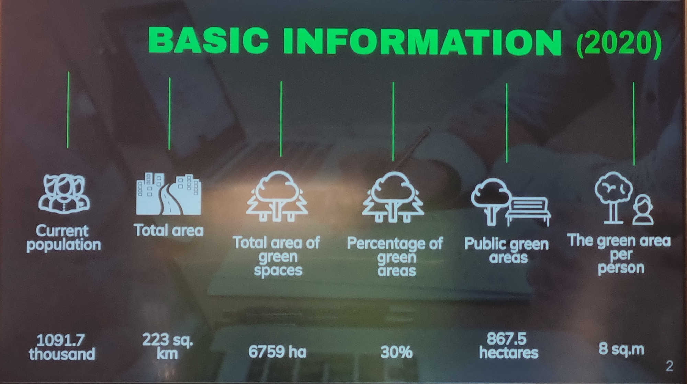
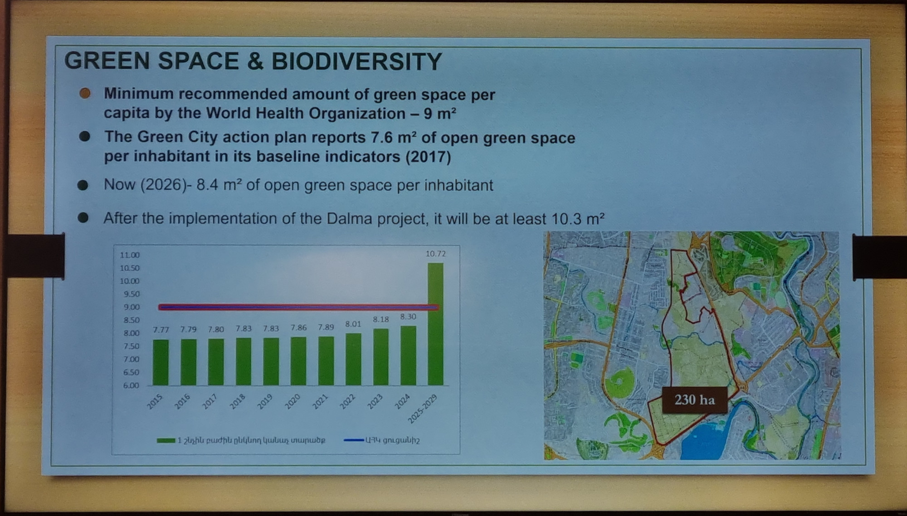
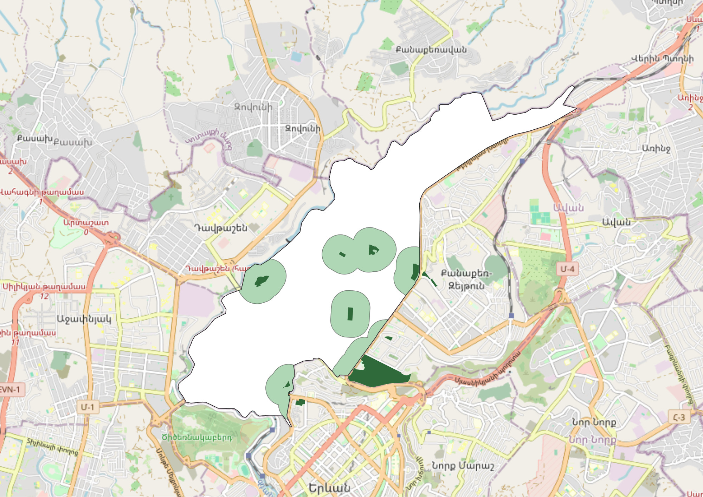
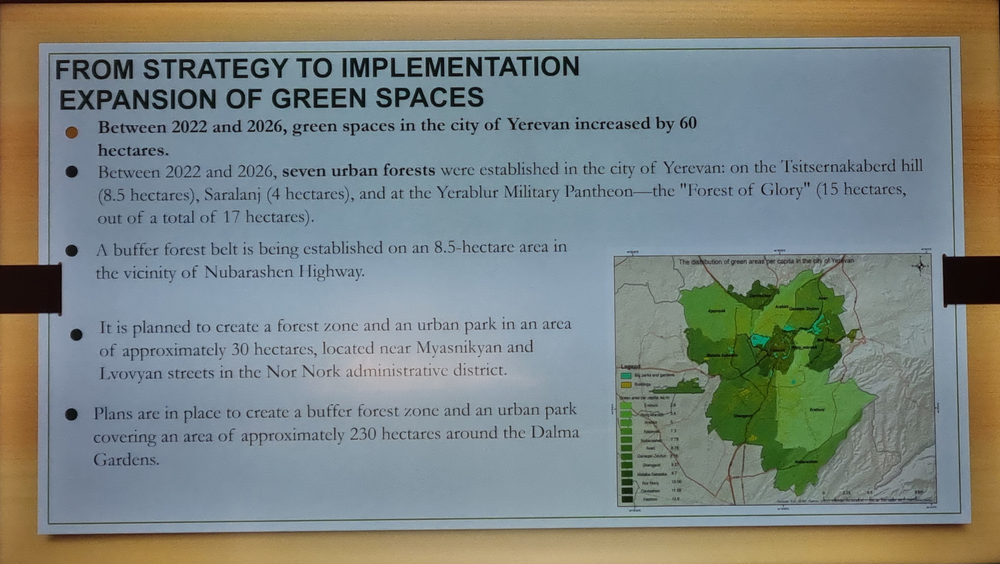

+++
title = "Որքա՞ն կանաչ տարածք է իրականում պետք քաղաքին"
description = "Ինչու «ԱՀԿ-ի ինը քառակուսի մետրը» գոյություն չունի, որտեղի՞ց է այն եկել և ինչպիսին է Երևանում այգիների հասանելիության իրական պատկերը։"
+++

Առողջապահության համաշխարհային կազմակերպության տվյալներով՝ քաղաքին պետք է առնվազն 9 քառակուսի մետր կանաչ տարածք մեկ բնակչի հաշվով։

Այս ինը քառակուսի մետրը համարվում է նվազագույն շեմ։ Իսկ իդեալական ցուցանիշը 20-50 քառակուսի մետրն է՝ մեկ մարդու հաշվով, որը հաճախ են հիշատակում որպես առողջ քաղաքի միջազգային չափանիշ։

Երևանի պաշտոնական տվյալներով՝ քաղաքում մեկ բնակչին բաժին է ընկնում 8,4 քառակուսի մետր՝ այդ շեմից մի փոքր պակաս։ Իր [«Կանաչ քաղաք» գործողությունների ծրագրում](/hy/guidelines/legal/gcap/) քաղաքապետարանը նպատակ է դրել մինչև 2030 թվականը հասնել 10 քառակուսի մետրի, իսկ պակասը պետք է լրացնեն խոշոր նախագծերը՝ 230 հեկտարանոց «Դալմա» այգին և լանջերի անտառապատումը։ Թղթի վրա այդ մեծ տարածքները լրացնում են պակասը։ Նպատակը համարվում է կատարված, իսկ քաղաքը՝ կանաչ։

> Սլայդ քաղաքապետարանի շնորհանդեսից՝ COP17-ի հարակից միջոցառման ժամանակ։

Խնդիրն այն է, որ նման չափանիշ պարզապես գոյություն չունի։ Սա [առասպել է](https://luisinostroza.com/a-dragon-in-my-garage-the-myth-of-the-9-m2-of-green-space-per-capita/)։

## Կանոն, որը երբեք չի եղել

ԱՀԿ-ն բազմաթիվ հետազոտություններ է հրապարակել այն մասին, թե ինչպես է քաղաքային բնությունը պաշտպանում մարդու առողջությունը։ Բայց նրա ո՛չ վերլուծական զեկույցներում, ո՛չ էլ գործնական ուղեցույցներում 9 քառակուսի մետրի նորմ երբեք չի եղել։ Ավելին, կանաչ տարածքների ցուցանիշների վերաբերյալ իր [ուղեցույցում](https://www.who.int/europe/publications/i/item/WHO-EURO-2016-3352-43111-60341) ԱՀԿ-ն չափում է այգիների հասանելիությունը, ոչ թե մեկ մարդուն բաժին ընկնող մակերեսը։ Գլխավոր ցուցանիշն այն է, թե բնակիչների որ մասն է ապրում առնվազն 0,5 հեկտարանոց հանրային այգուց 300 մետր հեռավորության վրա։ [2017 թվականի գործնական ուղեցույցը](https://www.who.int/europe/publications/i/item/9789289052498) կրկնում է նույն կանոնը՝ 0,5-1 հեկտարանոց այգի՝ տնից 300 մետրի սահմաններում։ Քաղաքի ամբողջ կանաչ տարածքը բնակիչների թվի վրա բաժանելու մեթոդաբանություն ԱՀԿ-ն ընդհանրապես չունի։

Այդ դեպքում որտեղի՞ց է հայտնվել այս 9 քառակուսի մետրը։

Այս թիվը ծագել է 1968 թվականի իտալական քաղաքաշինական մի նորմից։ Հետպատերազմյան Իտալիայում քաղաքաշինարարները նոր թաղամասերի համար գոտիավորման կարգ սահմանեցին։ Կառուցապատողներից պահանջվում էր ամեն բնակչի հաշվով հատկացնել 18 քառակուսի մետր հանրային տարածք՝ բաժանված չորս հստակ մասի՝ 4,5-ը՝ դպրոցներին, 2-ը՝ հասարակական շենքերին, 2,5-ը՝ ավտոկայանատեղիներին և ուղիղ 9-ը՝ հանրային այգիներին։

Դա իտալական բնակելի թաղամասերի համար նախատեսված տեղական նորմ էր՝ գրեթե վաթսուն տարի առաջ։ Տասնամյակների ընթացքում միջազգային զեկույցներով, թարգմանություններով ու փաստաթղթերով շրջանառվելիս այդ տեղական չափանիշը կորցրեց իր նախնական ենթատեքստը և սկսեց ներկայացվել որպես Առողջապահության համաշխարհային կազմակերպության պահանջ։

## Ինչու են քաղաքային միջինները մոլորեցնում

Ինչո՞ւ է «մեկ մարդու հաշվով մակերես» ցուցանիշն այդքան տարածված։ Որովհետև միջին թիվը թաքցնում է, թե իրականում որտեղ է կանաչը։

Միջին ցուցանիշը պարզ թվաբանություն է։ Քարտեզի վրայի ամբողջ կանաչ հողը բաժանում են 1,1 միլիոն բնակչի վրա ու հրապարակում արդյունքը։ Ոչ ոք չի հարցնում՝ մարդիկ կարո՞ղ են այնտեղ հասնել, ստվեր կա՞, թե՞ տարածքը փակ է ցանկապատի հետևում։

[Պաշտոնական տվյալներով](https://www.ecolur.org/en/news/forest/15886/)՝ Երևանում կա մոտ **6 760 հեկտար** կանաչ տարածք՝ քաղաքի ամբողջ մակերեսի գրեթե 30%-ը։ Սակայն քաղաքապետարանի հաշվետվություններով՝ բուն հանրային այգիները կազմում են ընդամենը մոտ **867 հեկտար**։ Մնացած 5 900 հեկտարը ներառում է ձորերի զառիթափ լանջեր, մասնավոր առևտրային սիզամարգեր, մայրուղիների եզրեր, գործարանային տարածքների բուսականություն և այլ անհասանելի հատվածներ։

Հրազդանի ձորի քարքարոտ լանջերի վայրի թփերը հաշվում են որպես կանաչ տարածք։ Գրասենյակի հետևի փակ սիզամարգը՝ նույնպես։ Հին երկաթգծի թումբը՝ նույնպես։ «Դալմայում» կամ հեռավոր լանջերին տնկած հարյուրավոր հեկտար ծառերը կբարձրացնեն պաշտոնական միջինը, բայց դրանից Նոր Նորքում տարեց մարդը ստվերոտ նստարան չի ունենա, իսկ Շենգավիթում երեխան՝ դասերից հետո բակում խաղալու անվտանգ տեղ։

Հեկտարները բնակչության թվի վրա բաժանելով՝ քաղաքը կանաչ է դառնում միայն աղյուսակներում, մինչդեռ փողոցներում մարդիկ շարունակում են փոշի շնչել։

> Սլայդ քաղաքապետարանի շնորհանդեսից՝ COP17-ի հարակից միջոցառման ժամանակ։

## 3-30-300 կանոնը և 300 մետրի շեմը

Ժամանակակից քաղաքաշինությունը շատ ավելի հստակ չափանիշ է կիրառում։ Քաղաքային միջինների փոխարեն այն չափում է, թե ինչին կարող է բնակիչը քայլելով հասնել իր տան շեմից։

Այս մոտեցումը հայտնի է որպես **3-30-300 կանոն**։ Միջազգային կազմակերպությունները, այդ թվում՝ [ՄԱԿ-ի Եվրոպական տնտեսական հանձնաժողովը (UNECE)](https://land.unece.org/treesincities/policy-brief), այն պաշտոնապես խորհուրդ են տալիս քաղաքային առողջ միջավայրի և կենսաբազմազանության պահպանման համար։ Կանոնը հիմնված է երեք պարզ հարցի վրա՝

1. **3 ծառ.** Տեսնո՞ւմ եք առնվազն երեք ծառ ձեր տնից, դպրոցից կամ աշխատավայրից։ Ծառերին ամեն օր նայելն ապացուցված կերպով նվազեցնում է սթրեսը և նպաստում հոգեկան առողջությանը։

2. **30% սաղարթ.** Ծածկո՞ւմ են ծառերի սաղարթները ձեր թաղամասի տարածքի առնվազն 30%-ը։ Տերևները ստվեր են գցում, ամռան տապին հովացնում փողոցները և պահում փոշին։

3. **300 մետր.** Կա՞ ձեր տնից 300 մետր հեռավորության վրա բաց հանրային այգի։ (Այս 300 մետրը բխում է ամենօրյա բացօթյա հանգստի վերաբերյալ ԱՀԿ-ի առաջարկություններից։)

Երեք կետն էլ էական են։ Սակայն այս հոդվածում մենք կենտրոնանում ենք հենց **300 մետրի կանոնի** վրա։

Մենք առանձնացրել ենք 300 մետրը, որովհետև այդ ցուցանիշը կարելի է ստուգել արդեն այսօր՝ բաց քարտեզներով, և որովհետև այն անմիջականորեն կապված է առօրյա կյանքի հետ։ Քաղաքի ամեն ծառ հաշվելու համար պետք է մեծ գույքագրում անել, իսկ սաղարթների մակերեսը չափելու համար՝ արբանյակային մանրամասն վերլուծություն։ Իսկ այգու հասանելիությունը կարելի է բաց քարտեզով ստուգել հենց հիմա։ Այն պատասխանում է շատ գործնական հարցի՝ կարո՞ղ եք դուրս գալ տնից և հինգ րոպեում հասնել այգի։

## Բակն ու այգին տարբեր խնդիրներ են լուծում

Երևանցիները հաճախ հարցնում են՝ եթե բակում մի քանի ծառ ու նստարան կա, դա համարվո՞ւմ է այգի։

Երկու տարածքն էլ կարևոր են, բայց ունեն տարբեր դերեր՝

- **Բակը՝** պետք է թաղամասի ամենօրյա հովացման և շենքի մոտ հանգստանալու համար։ Բակի ստվերոտ ծառերը հովացնում են շենքերի միջև եղած օդը, պահում են փոշին բաց լուսամուտներից և փոքր երեխաներին անվտանգ տեղ տալիս հենց տան մոտ։ Ամեն բակ ունի պաշտպանության և ծառերի կարիք։

- **Հանրային այգին՝** բակը չի կարող փոխարինել այգուն։ Լիարժեք հանրային այգուն պետք է առնվազն կես հեկտար՝ մոտավորապես մեկ սովորական քաղաքային թաղամաս։ Նման տարածքը հնարավորություն է տալիս ունենալ ճեմուղիներ, մարզվելու տեղ, անընդհատ ստվեր և հանգիստ ժամանց բաց երկնքի տակ՝ մեքենաներից ու բնակարանների պատուհաններից հեռու։

Նեղ դեկորատիվ սիզամարգերն ու օղակաձև խաչմերուկների ծաղկանոցներն այդ նպատակին չեն ծառայում։ Եթե ճանապարհի եզրի ամեն փոքրիկ կանաչ հատված համարենք այգի, քարտեզի վրա պատկերը լիարժեք կթվա, բայց թաղամասերը կմնան առանց զբոսնելու տեղի։

## Ինչպիսին է Երևանն իրականում

Մենք ստուգեցինք 300 մետրի կանոնը Երևանի բոլոր տասներկու վարչական շրջաններում։ Քարտեզի վրա նշեցինք առնվազն կես հեկտար մակերես ունեցող բոլոր բաց հանրային այգիները։

Հետո յուրաքանչյուր այգու շուրջ գծեցինք 300 մետրանոց շառավիղ՝ չափելու, թե շրջանի որ մասն է ընկնում հինգ րոպեանոց զբոսանքի սահմաններում՝

| Շրջան                 | Տարածք (կմ²) | Տարածքի մասնաբաժինը այգուց 300 մ-ում |
| --------------------- | ------------ | ------------------------------------ |
| **Կենտրոն**           | 13.54        | 55.9%                                |
| **Քանաքեռ-Զեյթուն**   | 7.78         | 30.1%                                |
| **Արաբկիր**           | 12.76        | 20.8%                                |
| **Նոր Նորք**          | 14.46        | 15.9%                                |
| **Ավան**              | 6.83         | 15.2%                                |
| **Դավթաշեն**          | 6.62         | 13.8%                                |
| **Աջափնյակ**          | 25.97        | 13.7%                                |
| **Մալաթիա-Սեբաստիա**  | 24.98        | 12.8%                                |
| **Շենգավիթ**          | 40.31        | 4.7%                                 |
| **Էրեբունի**          | 42.59        | 4.1%                                 |
| **Նուբարաշեն**        | 24.97        | 1.5%                                 |
| **Նորք-Մարաշ**        | 4.99         | 0.0%                                 |
| **Քաղաքում ընդամենը** | **225.80**   | **13.5%**                            |

Ամբողջ քաղաքում Երևանի տարածքի միայն **13,5%-ն** է գտնվում առնվազն կես հեկտար մակերեսով հանրային այգուց 300 մետր հեռավորության վրա։ Քաղաքի գրեթե 87%-ն իր մոտակայքում նման այգի չունի։

> Այգիների հասանելիությունը Արաբկիրում։ Տվյալները՝ OpenStreetMap-ից։

**Կարևոր նշում.** Այս հաշվարկները հիմնված են քարտեզի ուղիղ գծերի վրա։ Իրականում մարդիկ հազվադեպ են թռչում։ Երբ հետիոտնը ստիպված է լինում շրջանցել երկար պարիսպներ, անցնել կոտրված աստիճաններով կամ երկար ճանապարհ գնալ անվտանգ անցում չգտնելու պատճառով, իրական հեռավորությունն ավելի է մեծանում։ Այնպես որ այս թվերը դեռ լավատեսական են, իսկ տեղերում իրական պատկերն ավելի սահմանափակ է։

Կենտրոնում տարածքի կեսից ավելին այգու մոտ է։ Իսկ Շենգավիթում և Էրեբունիում, որտեղ տասնյակ հազարավոր ընտանիքներ են ապրում, հասանելիությունը 5%-ից էլ ցածր է։ Նորք-Մարաշում ընդհանրապես համապատասխան հանրային այգի չկա։ Մեկ մարդու հաշվով 8,4 քառակուսի մետր պաշտոնական միջինը այս իրականությունը չի արտացոլում։

> Սլայդ քաղաքապետարանի շնորհանդեսից՝ COP17-ի հարակից միջոցառման ժամանակ։

## Որտեղի՞ց գտնել հող

Կարելի է կարծել, թե խիտ կառուցապատված թաղամասերում նոր այգիների համար տեղ պարզապես չի մնացել։ Բայց Երևանում իրականում հնարավորություններ կան՝

1. **Միավորել ազատված բակերը**

   Քաղաքապետարանը բակերից հետևողականորեն քանդում է ապօրինի ավտոտնակները։ Շատ դեպքերում այդ ազատված տարածքները դառնում են փոքր խաղահրապարակներ կամ մարզահրապարակներ։ Խաղահրապարակները պետքական են, բայց այգի չեն փոխարինում։

   Ազատված տարածքը հաճախ 0,2-0,3 հեկտար է լինում։ Այդ հողն արդեն համայնքային է և գտնվում է հենց այնտեղ, որտեղ մարդիկ են ապրում։ Եթե նույն թաղամասի հարևան ազատված բակերը նախագծվեն միասին, ոչ թե առանձին-առանձին, դրանք կարող են միավորվել և դառնալ մինչև 0,5 հեկտար։ Այդպես կստեղծվի իսկական թաղամասային այգի՝ ստվերոտ ծառերով ու նստարաններով։

2. **Կառուցապատման թույլտվությունները կապել այգու իրական հասանելիության հետ**

   Այժմ նոր բնակելի համալիրների նախագծերում հաճախ նշում են կանաչապատ տարածքներ, բայց գործնականում սահմանափակվում են նեղ սիզամարգերով ու փոքր դեկորատիվ տնկիներով, որոնք ո՛չ ստվեր են տալիս, ո՛չ էլ հարմար են հանգստի համար։

   Ավելի արդյունավետ մոտեցում կլինի թույլտվությունները կապել այգիների հասանելիության հետ՝ **բոլոր նոր կառուցվող բնակելի շենքերը պետք է գտնվեն 0,5 հեկտար մակերեսով բաց հանրային այգուց առավելագույնը 300 մետր քայլելու հեռավորության վրա։**

   - Խոշոր համալիրների դեպքում լուծումը պարզ է։ Կառուցապատողը հենց իր տարածքի ներսում նախագծում և բացում է 0,5 հեկտարանոց հանրային այգի։

   - Մեկ շենքով կառուցապատման դեպքում, երբ հողամասը փոքր է, տեղում այգի սարքել չի ստացվի։ Այդպիսի չափանիշի պայմաններում կառուցապատողը պետք է հարևան կառուցապատողների կամ թաղապետարանի հետ համատեղ մոտակայքում հող գտնի ու ֆինանսավորի 0,5 հեկտարանոց ընդհանուր հանրային այգու ստեղծումը՝ նախքան շենքի շահագործումը, կամ էլ կառուցի այնտեղ, որտեղ այգին արդեն հասանելի է։

   Այսպես նոր շինարարությունը թաղամասին կտա իրական կանաչ տարածք, ոչ թե պարզապես խտություն կավելացնի այնտեղ, որտեղ այգիներ չկան։

3. **Ժամանակավոր պայմանագրերով օգտագործել դատարկ հողամասերը**

   Երևանում ցանկապատված մասնավոր հողամասերը հաճախ տարիներով դատարկ են մնում՝ սպասելով շինարարության ֆինանսավորմանը։ Քաղաքը կարող է ժամանակավոր կանաչապատման պայմանագրեր առաջարկել։ Քաղաքապետարանը հարթեցնում է տարածքը, դնում նստարաններ, անցկացնում արահետներ ու ծառեր տնկում, իսկ սեփականատերը մինչև շինթույլտվություն ստանալն ազատվում է գույքահարկից։ Գույքը մնում է տիրոջը, քաղաքը հող գնելու վրա գումար չի ծախսում, իսկ թաղամասը մի քանի տարով ստանում է հարմարավետ այգի։

## Ինչ կարող են անել բնակիչները

Թաղամասում ավելի շատ կանաչ ունենալու համար պարտադիր չէ անընդհատ վիճել։ Օգնում են փաստերով ու փաստաթղթերով հիմնավորված հստակ դիմումները։ Թաղապետարաններն ու քաղաքապետարանը շատ ավելի արագ են արձագանքում, երբ դիմումում նշված են կոնկրետ հասցեներ ու չափանիշներ՝

- **Առաջարկեք այգի քանդված ավտոտնակների տեղում։** Երբ ձեր բակում հեռացնում են ապօրինի ավտոտնակները, գրավոր դիմում ուղարկեք թաղապետարան և քաղաքապետարան՝ [e-request.am](https://e-request.am) կայքով։ Խնդրեք հարևան ազատված բակերից մեկ ընդհանուր կանաչ այգի սարքել՝ ստվերոտ ծառերով ու նստարաններով, իսկ մանկական ու մարզահրապարակները տեղավորել հենց այդ այգու մեջ, ոչ թե առանձին-առանձին՝ ամեն բակում։

- **Հարցրեք փակ հանրային տարածքների մասին։** Եթե ձեր թաղամասում հանրային այգին ցանկապատել են, դարպաս են դրել կամ մուտքը փակել, լուսանկարեք և [e-request.am](https://e-request.am)-ով հարցում ուղարկեք՝ պարզելու, թե ինչ կարգավիճակ ունի այդ տարածքը և ինչու է այն փակ հանրության առաջ։

- **Բարձրաձայնեք նոր շենքերի թերի կանաչապատման մասին։** Եթե նոր բնակելի համալիրի բակում կանաչապատումն ակնհայտորեն զիջում է խոստացվածին, [e-request.am](https://e-request.am)-ով դիմեք թաղապետարան ու քաղաքապետարան՝ պահանջելով ստուգել հաստատված նախագծի համապատասխանությունը։

- **Խնամեք ձեր բակի ծառերը։** Քաղաքը կանաչ պահելու լավագույն միջոցը հասուն ծառերը փրկելն է։ Ամռան չոր ամիսներին ջրեք շենքի մոտի նորատունկ ծառերը, մի՛ թողեք փչացնել արմատների հողը և քաղաքային ծառայություններին տեղյակ պահեք, եթե ծառերը վնասված են կամ չորանում են։

Երևանի կանաչապատման մասին խոսելիս արժե վերջապես մի կողմ դնել 9 մ²-ի առասպելը։

Կարևոր է գործնական հարցը՝ կարո՞ղ է տարեց մարդը կամ երեխան տնից հինգ րոպեում հասնել ծառերի ստվերին ու նստել նստարանին։ Սա պարզ ու իրատեսական չափանիշ է, որին կարող է ձգտել յուրաքանչյուր թաղամաս։

_Այս վերլուծությունը պատրաստվել է «Կանաչ Երևան»-ի համար՝ OpenStreetMap-ի բաց տվյալների և հանրային հաշվետվությունների հիման վրա։_
