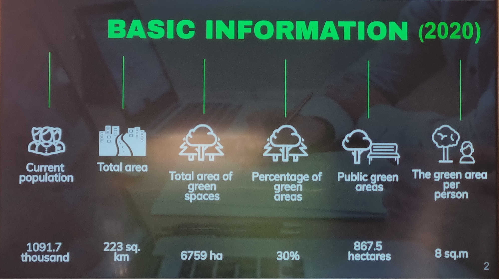
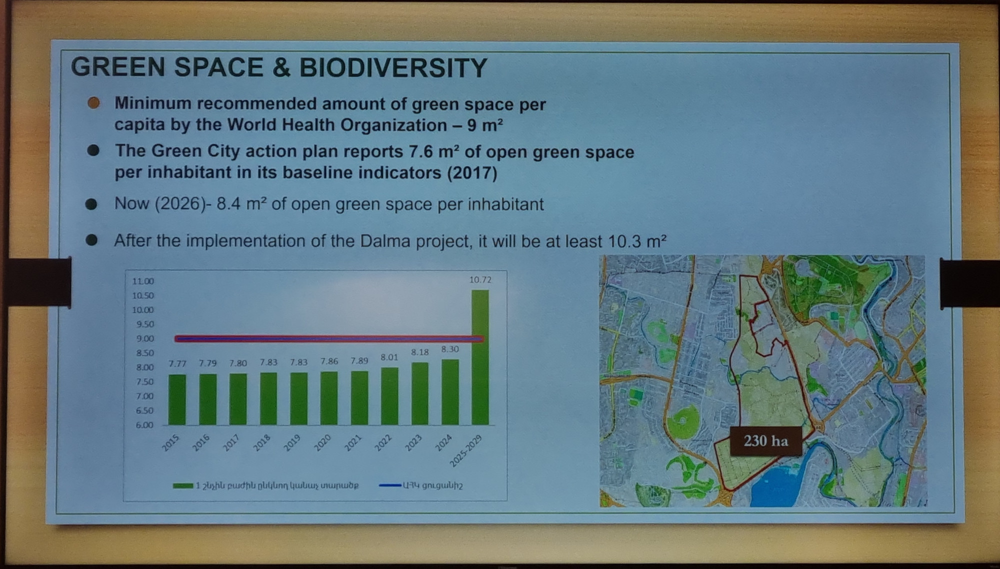
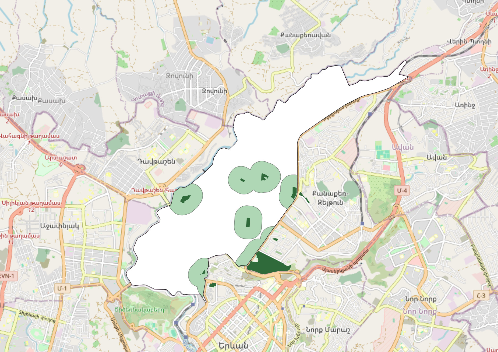
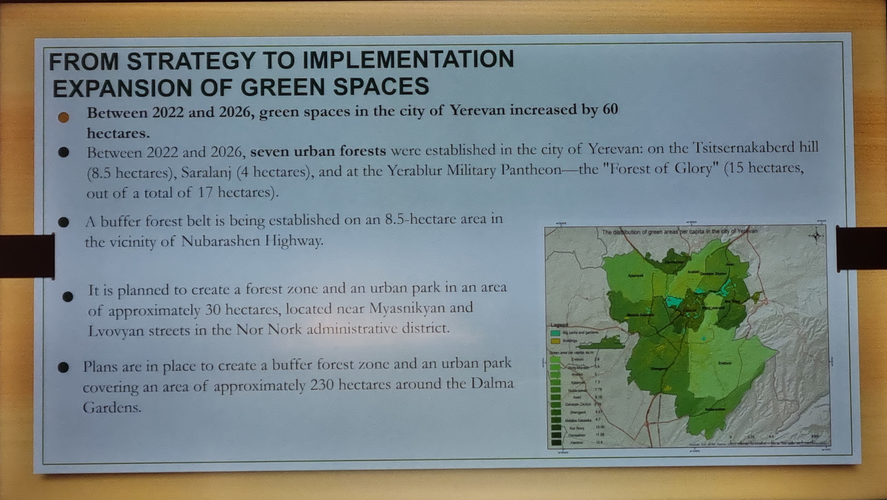

+++
title = "How Much Green Space Does a City Actually Need?"
+++

According to the World Health Organization, a city needs at least 9 square meters of green space for every resident.

Nine is presented as the bare minimum. Above that sits the ideal target: 20 to 50 square meters per person, which is widely cited as the international standard for a healthy city.

Yerevan reports 8.4 square meters per resident—just short of that baseline. In its official [Green City Action Plan](/guidelines/legal/gcap/), the city set a target to cross 10 square meters per resident by 2030, with flagship projects like the 230-hectare Dalma Gardens park and hillside afforestation intended to close the gap. On paper, when these large parcels are added, the math works out, the target is reached, and the city looks green.

> A slide from the municipal presentation on a COP17 side event.

The problem is simple: this standard does not exist. It is [a myth](https://luisinostroza.com/a-dragon-in-my-garage-the-myth-of-the-9-m2-of-green-space-per-capita/).

## A Rule That Never Existed

The World Health Organization has published extensive research on how urban nature protects human health. But neither its research reviews nor its action guidelines have ever established a 9-square-meter rule. In fact, the WHO's own [guidance on green space indicators](https://www.who.int/europe/publications/i/item/WHO-EURO-2016-3352-43111-60341) measures access, not area per person: its recommended indicator is the share of residents living within 300 metres of a public park of at least 0.5 hectares, and its [2017 action brief](https://www.who.int/europe/publications/i/item/9789289052498) sets the same rule of thumb. Dividing a city's total green area by its census population is not a WHO metric at all.

So where did the number nine come from?

It comes from a local Italian planning decree passed in 1968. In post-war Italy, planners created a zoning formula for new housing developments. They required builders to allocate 18 square meters of public space per resident, divided into four fixed portions: 4.5 for schools, 2 for community facilities, 2.5 for parking, and exactly 9 square meters for public parks.

It was a local zoning budget for Italian housing blocks nearly sixty years ago. Over decades of international reports, translations, and planning summaries, that local standard lost its context and picked up the name of the World Health Organization.

## Why City Averages Are Misleading

Why is an average per person such a popular metric? Because an average hides where the green space actually is.

An average is pure arithmetic: take all the green land on a map, divide it by 1.1 million residents, and publish the number. It does not ask who can walk there, whether there is any shade, or whether the land is locked behind a fence.

Yerevan's [official records](https://www.ecolur.org/en/news/forest/15886/) show about **6,760 hectares** of green territory—nearly 30% of the entire municipal area. But the city's own reports count only about **867 hectares** of actual public parks. The remaining 5,900 hectares include steep canyon cliffs, private commercial lawns, highway borders, industrial vegetation, and closed government grounds.

Wild bushes on the rock slopes of the Hrazdan gorge count as green territory. An inaccessible bank behind an institution counts. An old railway embankment counts. Adding hundreds of hectares of trees at Dalma Gardens or on distant city slopes will raise the official average, but it will not give an older resident in Nor Norq a shaded bench to sit on, or a child in Shengavit a safe place to play after school.

Dividing total hectares by the population makes a city look green on a spreadsheet while people on the street breathe dust.

> A slide from the municipal presentation on a COP17 side event.

## The 3-30-300 Rule: Why We Focus on 300 Meters

Modern urban planning uses a much clearer test. Instead of citywide averages, it evaluates what residents can actually reach from their front doors.

This framework is known as the **3-30-300 rule**, and it is now formally recommended by international bodies including the [United Nations Economic Commission for Europe (UNECE)](https://land.unece.org/treesincities/policy-brief) to advance urban health and biodiversity goals. It asks three simple questions:

1. **3 Trees:** Can you see at least three trees from your home, school, or workplace? Daily visual contact with trees is proven to lower stress and support mental health.

2. **30% Canopy:** Does your neighborhood have at least 30% tree canopy cover? Tree leaves provide shade, cool down the streets during summer heat, and filter airborne dust.

3. **300 Meters:** Is there an open public park within 300 meters of your home? (This 300-meter access line directly reflects WHO recommendations for daily outdoor recreation).

All three parts are essential. But in this article, we focus specifically on the **300-meter rule**.

We focus on 300 meters because it is the metric that can be verified today using open map data, and it directly reflects daily life. Counting every individual street tree requires an extensive citywide field inventory, and measuring exact tree canopy requires detailed satellite analysis. But park access can be checked on an open map right now. It answers a practical question: can you walk out of your building and reach a park within five minutes?

## Courtyards and Parks Do Different Jobs

People in Yerevan often ask: if an apartment courtyard has a few trees and a bench, does that count as a park?

Both spaces are important, but they serve different functions:

- **The courtyard:** Essential for daily neighborhood cooling and doorstep life. Shaded courtyard trees cool the air between buildings, reduce dust near open windows, and give young children a safe place right outside the door. Every courtyard needs protection and trees.

- **The public park (at least 0.5 hectares):** A courtyard cannot replace a park. A functional public park needs to be at least half a hectare (about the size of a standard city block). That scale provides space for walking loops, physical exercise, continuous shade canopy, and quiet time outdoors away from vehicle traffic and residential windows.

Small ornamental grass strips and planted traffic circles do not serve this purpose. If every small patch of decorative roadside greenery is counted as parkland, the map appears full while neighborhoods remain without a place to walk.

## What Yerevan Actually Looks Like

We evaluated the 300-meter rule for all twelve administrative districts of Yerevan. We mapped every open public park that is at least half a hectare in size.

Then, we drew a 300-meter boundary around each park to measure how much of the district falls within that five-minute walk:

| District             | Area (km²) | Land within 300 m of a park |
| -------------------- | ---------- | --------------------------- |
| **Kentron**          | 13.54      | 55.9%                       |
| **Qanaqer-Zeytun**   | 7.78       | 30.1%                       |
| **Arabkir**          | 12.76      | 20.8%                       |
| **Nor Norq**         | 14.46      | 15.9%                       |
| **Avan**             | 6.83       | 15.2%                       |
| **Davtashen**        | 6.62       | 13.8%                       |
| **Ajapnyak**         | 25.97      | 13.7%                       |
| **Malatia-Sebastia** | 24.98      | 12.8%                       |
| **Shengavit**        | 40.31      | 4.7%                        |
| **Erebuni**          | 42.59      | 4.1%                        |
| **Nubarashen**       | 24.97      | 1.5%                        |
| **Norq Marash**      | 4.99       | 0.0%                        |
| **Citywide Total**   | **225.80** | **13.5%**                   |

Across the entire city, only **13.5% of Yerevan's land** sits within a 300-meter walk of a public park of at least half a hectare. Nearly 87% of the city has no qualifying park nearby.

> Park accessibility in Arabkir district. Data from OpenStreetMap.

**An important note:** These calculations measure straight lines on a map. In reality, human beings rarely fly. When pedestrians must walk around long walls, navigate broken steps, or make detours because there is no safe street crossing, the actual walking distance is much longer. These figures are therefore optimistic; the real walking situation on the ground is more restricted.

In Kentron, more than half the land is near a park. But in Shengavit and Erebuni—where tens of thousands of families live—coverage falls below 5%. In Norq Marash, there is no qualifying public park at all. Relying on an official citywide average of 8.4 square meters per person does not reflect the reality of these neighborhoods.

> A slide from the municipal presentation on a COP17 side event.

## Practical Ways to Find Land

It is easy to assume that dense neighborhoods simply have no space left for new parks. But Yerevan produces practical opportunities quite often:

1. **Connect Cleared Courtyards**

   The city has made steady progress removing unauthorized metal garages from residential yards. In most cases, these cleared spaces are turned into small playgrounds or sports courts. Playgrounds are useful, but they do not replace parks.

   A cleared area is often 0.2 to 0.3 hectares. This land is already public and sits right where people live. When adjacent cleared yards within the same block are planned together rather than as isolated projects, they can combine to reach 0.5 hectares. That creates a real neighborhood park with shade trees and benches.

2. **Tie Building Approvals to Real Park Access**

   In current practice, new residential complexes often designate landscaped areas on their drawings, but this requirement is frequently met with narrow turf borders and small ornamental saplings that provide little shade or usable public space.

   A more effective planning approach would tie approvals directly to access: **all newly built residential housing should be located within a 300-meter walk of an accessible 0.5-hectare public park.**

   - For large multi-building developments, the solution is straightforward: the developer plans and opens a 0.5-hectare park within the project footprint as part of their landscaped area.

   - For single-entrance or infill buildings where the parcel is too small for a park, developers cannot provide one on-site. Under an access standard, they would need to coordinate with neighboring developers or the district administration to help assemble and finance a shared 0.5-hectare public park nearby before completion, or focus development where adequate park access already exists.

   This ensures that new construction contributes usable green space to the neighborhood rather than simply adding density to areas that lack parks.

3. **Use Vacant Land on Temporary Agreements**

   Fenced private plots across Yerevan often sit vacant for years while waiting for construction financing. The city could establish temporary greening agreements: the municipality installs simple paths, benches, and trees, while the property owner receives temporary property tax relief until construction permits are issued. The owner retains the asset, the city spends very little on land, and the neighborhood gains a usable park for several years.

## Simple Things Residents Can Do

Improving neighborhood green space does not require confrontation. It requires clear, polite communication supported by documented facts. District and municipal offices are far more responsive when requests cite specific locations and standards:

- **Propose park spaces when garages are cleared.** When unauthorized garages are removed near your building, submit a written proposal to your district administration (_taghapetaran_) and the city via [e-request.am](https://e-request.am). Ask that the adjacent cleared yards be turned into one green park with shade trees and benches, with playgrounds and sports courts placed inside it rather than one in each yard.

- **Inquire about blocked public spaces.** If a mapped public park in your area is fenced off, locked, or restricted, take a clear photo and send an inquiry through [e-request.am](https://e-request.am) asking about its public access status.

- **Check public green commitments on new developments.** If a new residential complex was approved in your neighborhood with commitments for public green space, submit an informational request through [e-request.am](https://e-request.am) asking whether the completed landscaping meets the approved design.

- **Care for neighborhood trees.** The most reliable way to maintain green coverage is to preserve mature trees that already exist. Water young trees outside your building during the dry summer months, protect soil around root zones, and notify municipal services through official channels if trees are damaged or dying.

When discussing urban greening in Yerevan, we should set aside the 9-square-meter myth.

The question that matters is practical: can an older resident or a child walk five minutes from home and sit under the shade of healthy trees? That is a clear, constructive standard that every neighborhood can work toward.

_This analysis was prepared for Kanach Yerevan using open geographic data from OpenStreetMap and public reports._
