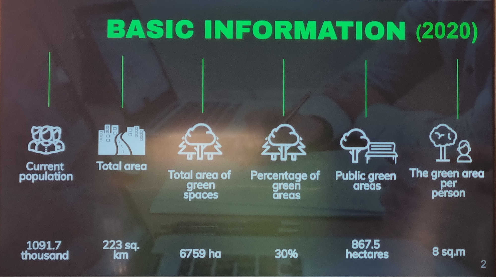
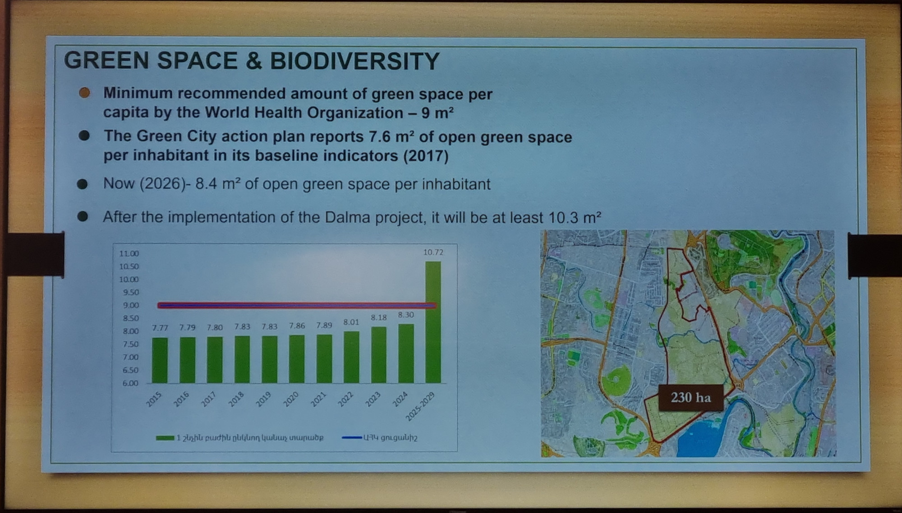
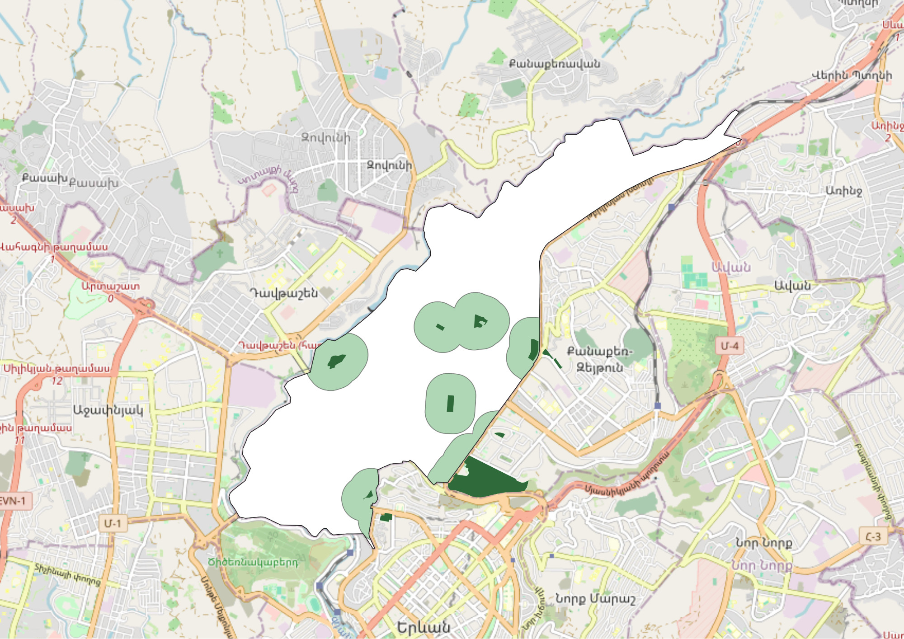
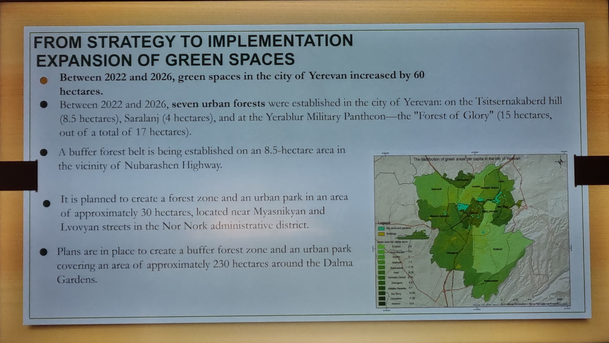

+++
title = "Сколько зелени на самом деле нужно городу?"
description = "Разбор мифа о девяти квадратных метрах на человека: откуда взялась эта норма, что в действительности рекомендует ВОЗ и как выглядит доступность парков в районах Еревана."
+++

По данным Всемирной организации здравоохранения, городу необходимо не менее 9 квадратных метров зелёных насаждений на каждого жителя.

Девять квадратных метров подаются как минимально допустимый уровень. Выше него — идеал: от 20 до 50 квадратных метров на человека, который широко цитируется как международный стандарт здорового города.

Ереван отчитывается о 8,4 квадратного метра на жителя — чуть ниже этой планки. В своём официальном [Плане действий «Зелёный город»](/ru/guidelines/legal/gcap/) город поставил цель к 2030 году перейти рубеж в 10 квадратных метров на жителя, а закрыть разрыв должны флагманские проекты — парк «Далма» на 230 гектаров и озеленение склонов. На бумаге эти крупные массивы закрывают разрыв: цель достигнута, город выглядит зелёным.

> Слайд из презентации мэрии на мероприятии в рамках COP17.

Проблема в том, что такого норматива не существует. Это [миф](https://luisinostroza.com/a-dragon-in-my-garage-the-myth-of-the-9-m2-of-green-space-per-capita/).

## Правило, которого никогда не было

ВОЗ публикует немало исследований о том, как городская природа защищает здоровье человека. Но ни её обзоры, ни её практические рекомендации никогда не устанавливали норму в 9 квадратных метров. Более того, в собственных [рекомендациях по показателям озеленения](https://www.who.int/europe/publications/i/item/WHO-EURO-2016-3352-43111-60341) ВОЗ измеряет доступность, а не площадь на человека: основной показатель — доля жителей, живущих в 300 метрах от общественного парка площадью не менее 0,5 гектара, а [практическое руководство 2017 года](https://www.who.int/europe/publications/i/item/9789289052498) повторяет тот же ориентир — парк площадью 0,5–1 гектара в 300 метрах от дома. В методике ВОЗ такого показателя — вся зелёная площадь города, делённая на население, — нет вовсе.

Так откуда же взялись эти 9 м²?

Эти 9 м² пришли из местного итальянского градостроительного декрета 1968 года. В послевоенной Италии проектировщики придумали норматив для новых жилых районов. Застройщиков обязали выделять 18 квадратных метров общественных пространств на каждого жителя, разбитых на четыре фиксированные доли: 4,5 — под школы, 2 — под объекты общественного назначения, 2,5 — под парковки и ровно 9 — под общественные парки.

Это был местный норматив для итальянских жилых кварталов почти шестидесятилетней давности. За десятилетия международных докладов, переводов и планировочных конспектов он потерял контекст и получил имя Всемирной организации здравоохранения.

## Почему средние значения по городу вводят в заблуждение

Почему показатель «площадь на человека» так популярен? Потому что он скрывает, где именно находится зелень.

Среднее — чистая арифметика: взять всю зелёную землю на карте, разделить на 1,1 миллиона жителей и опубликовать результат. Оно не спрашивает, кто может туда дойти, есть ли там тень и не заперта ли территория за забором.

По [официальным данным](https://www.ecolur.org/en/news/forest/15886/), в Ереване около **6 760 гектаров** озеленённых территорий — почти 30% всей площади города. Но в собственных отчётах мэрии настоящих общественных парков всего около **867 гектаров**. Остальные 5 900 гектаров — это обрывистые склоны каньонов, частные газоны при коммерческих объектах, обочины дорог, растительность в промзонах и другие недоступные территории.

Кустарники на скальных склонах Разданского ущелья идут в зачёт зелёных территорий. Недоступный газон за забором учреждения — тоже. Старая железнодорожная насыпь — тоже. Сотни гектаров деревьев в «Далме» или на дальних городских склонах поднимут официальное среднее, но пожилой житель Нор Норка так и не получит скамейку в тени, а ребёнок из Шенгавита — безопасное место, где можно играть после школы.

Деление гектаров на население делает город зелёным в таблице, пока люди на улице дышат пылью.

> Слайд из презентации мэрии на мероприятии в рамках COP17.

## Правило 3-30-300: почему считают 300 метров

Современная урбанистика пользуется куда более ясным критерием. Вместо средних по всему городу она смотрит, до чего в действительности может дойти житель от своего подъезда.

Этот подход известен как **правило 3-30-300**, и сегодня его официально рекомендуют международные организации, включая [Европейскую экономическую комиссию ООН (ЕЭК ООН)](https://land.unece.org/treesincities/policy-brief), для продвижения целей в области городского здоровья и биоразнообразия. Он задаёт три простых вопроса:

1. **3 дерева:** видите ли вы хотя бы три дерева из дома, школы или с работы? Ежедневный визуальный контакт с деревьями доказанно снижает стресс и поддерживает психическое здоровье.

2. **30% крон:** покрывают ли кроны деревьев хотя бы 30% площади вашего района? Листва даёт тень, охлаждает улицы в летнюю жару и задерживает пыль.

3. **300 метров:** есть ли в 300 метрах от дома открытый общественный парк? (Эта дистанция напрямую отражает рекомендации ВОЗ о ежедневном отдыхе на воздухе.)

Все три части важны. Но в этой статье мы говорим именно о **правиле 300 метров**.

Мы берём 300 метров, потому что этот показатель можно проверить уже сегодня по открытым картографическим данным, и потому что он напрямую отражает повседневную жизнь. Чтобы пересчитать каждое уличное дерево, нужна полная инвентаризация по всему городу, а чтобы измерить точную площадь крон — детальный спутниковый анализ. А доступность парка можно проверить по открытой карте прямо сейчас. Она отвечает на практический вопрос: можете ли вы выйти из подъезда и дойти до парка за пять минут?

## Двор и парк решают разные проблемы

Жители Еревана часто спрашивают: если во дворе есть несколько деревьев и скамейка, это считается парком?

Оба пространства важны, но выполняют разные задачи:

- **Двор:** нужен для ежедневного охлаждения района и жизни у порога. Тенистые дворовые деревья охлаждают воздух между домами, снижают запылённость у открытых окон и дают маленьким детям безопасное место прямо у дома. Каждый двор нуждается в защите и деревьях.

- **Общественный парк:** двор его не заменит. Полноценному общественному парку нужно как минимум полгектара — примерно размер городского квартала. Такой масштаб позволяет проложить прогулочные дорожки, заниматься спортом, обеспечить сплошную тень и тихо отдохнуть на воздухе вдали от машин и жилых окон.

Узкие декоративные газоны и цветники на круговых развязках этой задачи не решают. Если каждый декоративный островок у дороги считать парком, карта выглядит заполненной, а район остаётся без места для прогулки.

## Как выглядит Ереван на самом деле

Мы проверили правило 300 метров для всех двенадцати административных районов Еревана. Мы нанесли на карту каждый открытый общественный парк площадью не менее половины гектара.

Затем вокруг каждого парка мы очертили 300-метровую зону, чтобы измерить, какая часть района попадает в пятиминутную прогулку:

| Район                | Площадь (км²) | Доля территории в 300 м от парка |
| -------------------- | ------------- | -------------------------------- |
| **Кентрон**          | 13.54         | 55.9%                            |
| **Канакер-Зейтун**   | 7.78          | 30.1%                            |
| **Арабкир**          | 12.76         | 20.8%                            |
| **Нор Норк**         | 14.46         | 15.9%                            |
| **Аван**             | 6.83          | 15.2%                            |
| **Давташен**         | 6.62          | 13.8%                            |
| **Аджапняк**         | 25.97         | 13.7%                            |
| **Малатия-Себастия** | 24.98         | 12.8%                            |
| **Шенгавит**         | 40.31         | 4.7%                             |
| **Эребуни**          | 42.59         | 4.1%                             |
| **Нубарашен**        | 24.97         | 1.5%                             |
| **Норк-Мараш**       | 4.99          | 0.0%                             |
| **Всего по городу**  | **225.80**    | **13.5%**                        |

По всему городу лишь **13,5% территории Еревана** находятся в 300 метрах от общественного парка площадью не менее полгектара. Почти 87% города не имеют такого парка рядом.

> Доступность парков в Арабкире. Данные OpenStreetMap.

**Важная оговорка:** эти расчёты измеряют прямые линии на карте. В реальности люди редко летают. Когда пешеходу приходится обходить длинные заборы, карабкаться по сломанным лестницам или делать крюк из-за отсутствия безопасного перехода, реальное расстояние оказывается намного больше. Поэтому цифры здесь оптимистичны; на земле ситуация хуже.

В Кентроне больше половины территории рядом с парком. А в Шенгавите и Эребуни, где живут десятки тысяч семей, охват падает ниже 5%. В Норк-Мараше подходящего общественного парка нет вовсе. Официальное среднее в 8,4 квадратного метра на человека эту реальность не отражает.

> Слайд из презентации мэрии на мероприятии в рамках COP17.

## Где взять землю: практические решения

Легко предположить, что в плотной застройке места для новых парков просто не осталось. Но Ереван регулярно создаёт практические возможности:

1. **Соединять освобождённые дворы**

   Город последовательно убирает незаконные гаражи из жилых дворов. В большинстве случаев на их месте появляются небольшие детские площадки или спортивные корты. Площадки полезны, но парк они не заменяют.

   Освобождённый участок обычно занимает 0,2–0,3 гектара. Это уже общественная земля, и она находится там, где живут люди. Если соседние освобождённые дворы в пределах одного квартала планировать вместе, а не как отдельные проекты, они могут сложиться в 0,5 гектара. Так появляется настоящий районный парк с тенистыми деревьями и скамейками.

2. **Увязать разрешения на строительство с реальной доступностью парков**

   Сейчас новые жилые комплексы часто рисуют на своих планах озеленённые территории, но на деле это требование закрывают узкими полосами газона и мелкими декоративными саженцами, которые не дают ни тени, ни пригодного общественного пространства.

   Более действенный подход — увязывать согласования напрямую с доступностью: **все новые жилые дома должны находиться в 300 метрах от доступного общественного парка площадью 0,5 гектара.**

   - Для крупных комплексов из нескольких корпусов решение простое: застройщик проектирует и открывает парк на 0,5 гектара в границах участка как часть своей озеленённой территории.

   - Для домов с одним подъездом или точечной застройки, где участок мал для парка, застройщик не может создать его на месте. При норме доступности ему придётся договориться с соседними застройщиками или с районной администрацией, чтобы до сдачи объекта собрать участок под общий парк на 0,5 гектара и профинансировать его, либо строить там, где доступ к паркам уже есть.

   Так новое строительство приносит району пригодную зелень, а не просто добавляет плотность там, где парков и так нет.

3. **Осваивать пустующие участки по временным соглашениям**

   Огороженные частные участки по всему Еревану годами стоят пустыми в ожидании финансирования стройки. Город мог бы заключать временные соглашения об озеленении: мэрия обустраивает простые дорожки, скамейки и деревья, а собственник получает временную льготу по налогу на имущество до выдачи разрешения на строительство. Актив остаётся у владельца, город почти не тратит деньги на землю, а район получает пригодный парк на несколько лет.

## Что может сделать каждый житель

Чтобы в районе стало больше зелени, не обязательно вступать в конфликт. Нужны регулярные обращения, подкреплённые фактами и документами. Районные и городские службы отвечают гораздо охотнее, когда в обращении указаны конкретные адреса и нормативы:

- **Предлагайте парк на месте снесённых гаражей.** Когда рядом с вашим домом убирают незаконные гаражи, направьте письменное предложение в районную администрацию и в мэрию через [e-request.am](https://e-request.am). Попросите соединить соседние освобождённые участки в зелёный парк с тенистыми деревьями и скамейками, а не отдавать их только под парковку или огороженные корты.

- **Спрашивайте о закрытых общественных пространствах.** Если обозначенный на карте общественный парк в вашем районе огорожен, заперт или доступ в него ограничен, сделайте чёткое фото и отправьте запрос через [e-request.am](https://e-request.am) о статусе его общедоступности.

- **Обращайте внимание на озеленение новых ЖК.** Если вместо обещанных деревьев и газона во дворе нового комплекса положили плитку и посадили несколько декоративных кустиков, напишите через [e-request.am](https://e-request.am) и спросите, соответствует ли благоустройство утверждённому проекту.

- **Заботьтесь о деревьях рядом.** Самый надёжный способ сохранить город зелёным — беречь уже взрослые деревья. Поливайте молодые деревья у своего дома в сухие летние месяцы, защищайте почву в приствольных кругах и сообщайте городским службам через официальные каналы, если деревья повреждены или гибнут.

Говоря об озеленении Еревана, пора оставить в стороне миф о 9 м².

Имеет значение практический вопрос: может ли пожилой человек или ребёнок выйти из дома, за пять минут дойти до парка и сесть в тень здоровых деревьев? Это ясный и конструктивный критерий, к которому может стремиться каждый район.

_Материал подготовлен для «Канач Ереван» на основе открытых геоданных OpenStreetMap и публичных отчётов._
